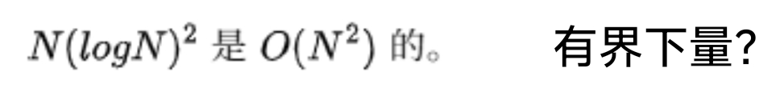
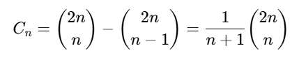
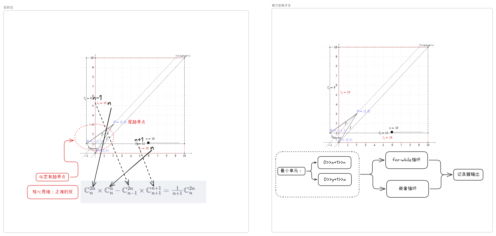
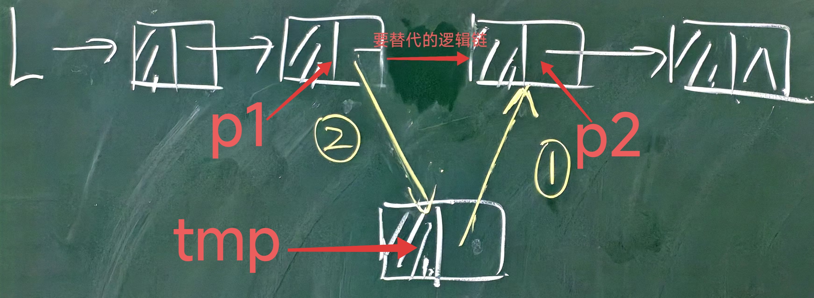

# 概念
> [!NOTE] 程序基本轮子
> 1. 语法
>> [!NOTE] 词法
> > 1. 值（函数/方法）：
> > 2. 关系：  
>> 	- 核心：   
>> 	数据复制：赋值，置空   
>> 	地址复制：赋值，置空   
>> 	- 联系：
>> 	引用（层级：地址->数据  ）
>> 	复制（同级）
>> 	- 进阶：  
>> 	删除/改变/增加~查找+赋值  
>> 	删除+赋值~插入/移动


> [!NOTE] 有界量
> 
> ```latex
> 当n->n₀时，
> n₀(logn₀)² /n₀²=(logn₀)² /n₀<1，
> 则：
> n₀(logn₀)² <n₀²成立
> 故证明成立。
> ```


> [!NOTE] 表达式模式
> 中缀表达式：（中序）
> $$a+b*c-d/e$$ 
>  后缀表达式：（后序）$$abc*+de/-$$
> 前缀表达式：（前序）
> $$-+a*bc/de$$
> 
> > [!NOTE] 核心思想
> > 将原先人类的中缀表达式的一步多线程计算操作转换为计算机偏好的单进程多步操作。
> 


> [!NOTE] 卡特兰数
>   
> 表达式：  $C_{n}=\mathbb{C}^{2n}_{n} \times \mathbb{C}^{n}_{n} -\mathbb{C}^{2n}_{n-1}=\frac{1}{n+1} \mathbb{C}^{2n}_{n}$
> 证明过程：  
> 
> - 图片查看：  
> 
 


> [!NOTE] 绝对值和循环值
> - 绝对值：
> 1. |front-back-middle| 
> (front-back)以 x=midlle 为左右对称线。
> - 循环值：
> 1. ( front - back +lenghth ) % lenghth
>  (front-back)在 lenghth 长度区间。
> 2. | |front - back| -lenghth|
> |front-back|在 lenghth 长度区间。


> [!NOTE] 比较排序算法
> 特点：满足<font color="#ffff00">区分</font>自身的<font color="#c00000">所有项的全排列</font>。  
> 运用：决策树有 $2^k$ 个叶子 ，但区分需要 $n!$ 个，故  
> $$\textcolor{white}{2^{k}\geq n!\\ 则k\geq\log_2(n!)=O(n\log n)}$$
  


> [!NOTE] 二叉搜索树
> 相对左节点值 < 相对根节点 < 相对右节点
> 上级根节点 < 下级相对左节点
> 删除：
> 无儿无女：直接删
> 有儿无女：子承父业
> 有儿有女：左子树最大，右子树最小


---
# 实践

> [!NOTE] 插入法
>   
> ```c
>  //L是单链表。p1表示插入前节点，p2表示插入后节点，tmp表示插入节点。
>  1. 头插法：
>  tmp->next=p1;
>  p1=tmp;
>  2. 中插法：
>  //操作p1和tmp：
>  tmp->next=p1->next;
>  p1->next=tmp;
>  //操作p2和tmp：
>  tmp->next=p2;
>  p1->next=tmp;
>  3. 尾插法：
>  p2->next=tmp;
>  p2=tmp;
> ```
> 
> 


> [!NOTE] 单向链表
> 
> 栈：   插入和删除同指针  
> 队列：     插入和删除异指针  


> [!NOTE] 顺序查找
> 
> - 标志位法


> [!NOTE] 分治算法
> 1. 二分查找：    
> 	   - <pre>时间复杂度：（k 表示执行二分的次数）</pre>
> 	   $$ n\times(\frac 12)^k=1 \\ k=\log_{2}n $$
> 2. 归并排序：  
> 3. 分治算法： 


> [!NOTE] 树
> 1. 查找次数（ASL）：  
> ∑(i=1,a)(i * ni)/n（每层节点 ni，总节点 n）  
> 总深度 a：log₂n+1  
> 判定树法  
>   2. 等比公示：  
> 	1+2+4+....+2ⁿ  
> 	2ⁿ⁺¹-1  


> [!failure]

> [!danger] 
> 